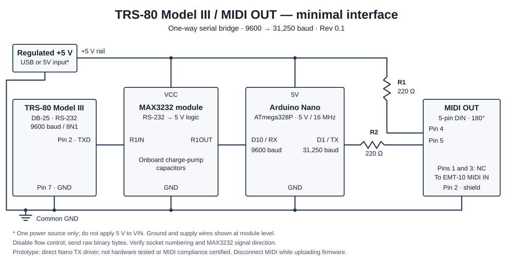

# TRS-80 Model III – Simple MIDI OUT

A minimal, external, one-way MIDI interface for the TRS-80 Model III and Yamaha EMT-10 AWM Sound Expander. No modification to the TRS-80 is required.

**Status (27 November 2026):** MIDISD v0.3 and the fast Nano firmware are the recommended hardware-tested baseline for direct FreHD SD-card playback. The project owner reported successful playback on the physical TRS-80 Model III and Yamaha EMT-10 after replacing the unsuccessful checked v0.2 protocol with v0.3. Extended reliability and precise timing measurements remain open. MIDIPLAY v0.9 remains available for DOS-image playback.

## How it works

The Model III sends raw MIDI bytes over its existing RS-232 port at 9600 baud (8N1). A MAX3232 module converts the RS-232 voltage levels to 5 V logic; a classic Arduino Nano receives the bytes and retransmits them at the MIDI rate of 31,250 baud.

```text
TRS-80 DB-25 TXD -> MAX3232 -> Nano D10 (RX)
                                  Nano D1 (TX) -> MIDI OUT -> EMT-10 MIDI IN
```

The stock Model III baud-rate generator does not support 31,250 baud. RS-232 and MIDI also use different electrical signalling. **Never wire RS-232 directly to MIDI IN.**

## Circuit schematic



[View schematic](hardware/minimal-midi-out.svg) · [Arduino firmware](firmware/serial_to_midi/serial_to_midi.ino)

## Parts list

| Qty | Part |
| --- | --- |
| 1 | Classic Arduino Nano, ATmega328P, 5 V / 16 MHz |
| 1 | MAX3232 RS-232-to-logic module, rated for 5 V operation, with onboard charge-pump capacitors |
| 2 | 220 ohm resistors, 1/4 W |
| 1 | 180-degree 5-pin DIN female socket |
| 1 | Mating DB-25 connector or breakout for the TRS-80 |
| 1 | Regulated 5 V supply, at least 200 mA (USB power is convenient) |
| As required | Wire, board and standard MIDI cable |

## Wiring

| From | To |
| --- | --- |
| TRS-80 DB-25 pin 2 (TXD) | MAX3232 R1IN (RS-232 input) |
| TRS-80 DB-25 pin 7 (signal ground) | Common GND |
| MAX3232 R1OUT (logic output) | Nano D10 |
| Nano 5V | MAX3232 VCC |
| Nano GND | MAX3232 GND and MIDI OUT DIN pin 2 |
| Nano 5V | R1 (220 ohm) -> MIDI OUT DIN pin 4 |
| Nano D1 / TX | R2 (220 ohm) -> MIDI OUT DIN pin 5 |

DIN pins 1 and 3 and Nano D11 remain unconnected. The DIN pin numbers identify terminals, not physical positions; verify against the socket's datasheet. MAX3232 breakout labels vary: verify the direction of the receiver rather than relying on TX/RX labels alone.

Power the Nano via USB, or use a suitable regulated 5 V supply at its 5V pin (not VIN); avoid simultaneously driving the 5V rail from separate supplies. The MAX3232 and MIDI output share that regulated rail. No power is taken from the TRS-80 serial port.

The direct Nano TX driver is a deliberately minimal prototype. A buffered output following the MIDI Association electrical specification is preferable for a formally compliant or production interface. The Yamaha's MIDI IN provides its own receiver isolation; no MIDI IN or return-data circuit is provided here.

## Firmware

Open `firmware/serial_to_midi/serial_to_midi.ino` in the Arduino IDE. Select the classic Arduino Nano (ATmega328P), the appropriate bootloader option and serial port. Disconnect the Yamaha while uploading or resetting the Nano, since bootloader traffic on D1 is not valid MIDI. No extra libraries beyond the AVR core's SoftwareSerial are needed.

The original transparent bridge does not interpret data or add line endings. Do not send debugging text over the MIDI UART.

For MIDISD v0.3 use the [fast Nano buffered sketch](player/firmware/serial_to_midi_fast/serial_to_midi_fast.ino). Same wiring and baud rates, 512-byte FIFO, nominal 160 ms lookahead, short-underrun recovery and active-note/pedal cleanup. **Install matching v0.3 firmware before selecting modes 4/5.** The [older v0.8/v0.9 buffered sketch](player/firmware/serial_to_midi_buffered/serial_to_midi_buffered.ino) remains available for legacy MIDIPLAY, as does the transparent bridge. These timed protocols are not general-purpose MIDI clock bridges.

## First hardware test

1. With the Yamaha disconnected, check the 5 V supply and verify that D1 idles high after boot.
2. Set the Model III serial software to 9600 baud, 8 data bits, no parity, one stop bit. Disable hardware/software flow control and any text translation.
3. Verify raw transmission at the MAX3232 output and 31,250-baud output on D1 with a logic analyser or oscilloscope if available.
4. Connect MIDI OUT to the Yamaha EMT-10 MIDI IN, set the receiver to channel 1 (or OMNI), and connect its audio output to an amplifier.
5. Send these raw bytes from the TRS-80, waiting about half a second between note-on and note-off:

| Action | Hex bytes | Decimal bytes |
| --- | --- | --- |
| Middle C on | 90 3C 64 | 144, 60, 100 |
| Middle C off | 90 3C 00 | 144, 60, 0 |
| E on | 90 40 64 | 144, 64, 100 |
| E off | 90 40 00 | 144, 64, 0 |
| G on | 90 43 64 | 144, 67, 100 |
| G off | 90 43 00 | 144, 67, 0 |

Send binary byte values, not ASCII hex strings. If a note sticks, explicitly send note-off for each active note or use the Yamaha's reset procedure. CC 123 (B0 7B 00) may be used if supported by the receiver.

## Model III MIDI player (v0.9)

The native Z80 player streams compatible format-0 SMF files from disk. LDOS 5.3.1 is the target; v0.5 has been hardware-tested. TRSDOS and physical hardware performance of v0.9 are not yet verified.

- [MIDIPLAY.CMD](player/MIDIPLAY.CMD) — 7,281-byte native executable
- [MIDIPLAY.ASM](player/MIDIPLAY.ASM) — Z80 source
- [ROCKJAZZ.MID](player/ROCKJAZZ.MID) — Silicon After Hours, original 176 BPM jazz-rock demo with all 12 solo voices, 27 Bass Split combinations and Yamaha effects
- [ROCKRAW.MID](player/ROCKRAW.MID) — original demo without SysEx, compatible with v0.7
- [make_rockjazz.py](player/make_rockjazz.py) — reproducible original composition generator
- [NYPLAY.BAS](player/NYPLAY.BAS) — BASIC player for converted data
- [SPLIT27.MID](player/SPLIT27.MID) — all 27 two-voice Bass Split combinations ([instructions](player/README-v0.7.md#two-voice-bass-split-mode-emt-10))
- [VOICES.MID](player/VOICES.MID) — original 12-voice EMT-10 demo
- [ATMOSPHX.MID](player/ATMOSPHX.MID) — **AtmosphereX**, original atmospheric E minor composition for EMT-10 strings, choir and occasional piano (3:38; medium pace; 80 bars; format 0).
- [PIANOBRS.MID](player/PIANOBRS.MID) — original 38.4-second Piano 1 / Brass test, with [generator](player/make_piano_brass.py)
- [convert_midi.py](player/convert_midi.py) — desktop conversion utility
- [Player documentation](player/README.md)

Transfer CMD and MID files in binary mode; preserve the CR-delimited BASIC source. At LDOS Ready, enter:

```text
MIDIPLAY ROCKJAZZ/MID:0
```

Select the actual LDOS tick frequency (2 = 25 Hz raw, 3 = 30 Hz raw; 4 = 25 Hz buffered, 5 = 30 Hz buffered with the new Nano firmware only). BREAK stops native playback. The EMT-10's voice assignments are not General MIDI patch numbers. Use converted files for this single-voice module.

The player supports running status, tempo changes, note and controller messages, whitelisted complete Yamaha EMT-10 parameter SysEx, pedal/all-notes-off cleanup and optional timed buffering. The dashboard displays the requested channel-1 instrument(s), held notes, sustain and the last 16 transmitted musical bytes in hex. The display shows data sent by the TRS-80, not MIDI OUT readback; buffered audio follows the display by about 160 ms. See [Z80 regression tests](player/TESTS.txt), [timing checks](player/TIMED_TESTS.txt) and [host-side firmware tests](player/BUFFER_TESTS.txt). Earlier [v0.7 notes](player/README.txt) and [v0.7 benchmarks](player/BENCHMARK.txt) remain historical references, not v0.9 benchmarks. Format 1 requires desktop conversion. Third-party song arrangements are not distributed here.

To audition Piano 1 and Brass in an alternating original piece, run `MIDIPLAY PIANOBRS/MID:0`. See the [historical demo documentation](player/README-v0.7.md#original-piano-and-brass-test-piece) for details and test results.

## Roland SC-55 Sound Canvas — SC55PLAY v0.2 (experimental)

A separate pure MIDI player for the Roland SC-55, using the optimised FreHD native SD-card playback engine. Supports all 16 MIDI channels, channel 10 drums, 32-bit MIDI track sizes, outgoing running status, restricted checksum-validated Roland GS SysEx and a 16-channel dashboard. No cassette output. v0.2 uses the same [fast v0.3 Nano firmware](player/firmware/serial_to_midi_fast/serial_to_midi_fast.ino) as MIDISD, including the 512-byte FIFO and 160 ms nominal lookahead. The previous one-byte timing marker protocol is retained; per-byte hexadecimal recording is removed.

- [SC55PLAY prototype and documentation](player/sc55play/README.md)
- [SC55PLAY.CMD](player/sc55play/SC55PLAY.CMD) — 5,415-byte native Z80 executable
- [SC55DEMO.MID](player/sc55play/SC55DEMO.MID) — original 16-channel audition
- [VELVET.MID](player/sc55play/VELVET.MID) — original slow, moody alternative rock composition

Both Roland demos passed exact-stream Z80/FreHD mock regression checks in raw and buffered modes; a separate multi-channel host-side Nano stress test passed. Physical SC-55 playback and cycle-accurate timing remain unverified. The Yamaha EMT-10 players and shared Nano firmware remain unchanged.

## FreHD direct SD-card playback (MIDISD v0.3 — recommended)

Native Z80 player for compatible MIDI files directly on the FreHD FAT SD card; songs need not be imported into DOS disk images.

| Player | Music source | LDOS command |
| --- | --- | --- |
| MIDISD v0.3 | Native FreHD SD card | `MIDISD` |
| MIDIPLAY v0.9 | DOS disk image | `MIDIPLAY ROCKJAZZ/MID:0` |

1. Install [MIDISD.CMD](player/MIDISD.CMD) in LDOS in binary mode. Upload the [matching fast Nano firmware](player/firmware/serial_to_midi_fast/serial_to_midi_fast.ino).
2. Copy [LINKTEST.MID](player/LINKTEST.MID), [VOICES.MID](player/VOICES.MID) or [ROCKJAZZ.MID](player/ROCKJAZZ.MID) directly onto the FAT SD card, using short 8.3 names.
3. Boot LDOS 5.3.1 and run `MIDISD`. Select files/folders with 1–9; N next page, R restart, U parent, BREAK exit.
4. Choose 2/3 for raw 25/30 Hz or 4/5 for fast buffered 25/30 Hz, matching your actual LDOS clock. Mode 4 is the starting point for a 25 Hz system.

Read-only FreHD native file commands, 255-byte reads, format 0/PPQN/65,535-byte track limit, Yamaha EMT-10 messages, live voice and note display. CRC/sequence framing and per-byte hexadecimal recording are removed from the playback path. 512-byte FIFO, nominal 160 ms lookahead, complete timing groups, short-delay rebuffering, note-off/pedal cleanup.

**Validation:** 9,109-byte CMD, load 6000h–8300h. Assembly reproduces the hardware-tested binary. Owner reported successful physical playback on 27 November 2026. Mock tests covered seven files at both buffered clock rates and raw 25 Hz; long-term physical timing/reliability not quantified.

[Assembly source](player/MIDISD.ASM) · [Build script](player/build_midisd.py) · [Installation and technical notes](player/README-MIDISD.md) · [Regression results](player/MIDISD-TESTS.md)

The checked v0.2 experiment remains on [midisd-checked-v02](https://github.com/royedmund/TRS-80-Model-III-Simple-Midi-Out/tree/midisd-checked-v02), not recommended for playback.

Acknowledgements: George Phillips (TRSvid and GIF/CMD) and Frédéric Vecoven (FreHD). See the FreHD notes for references.

## License

Original project code, documentation, schematic and original MIDI demonstrations are provided under the [MIT License](LICENSE). Third-party manuals, songs and recordings are not included or licensed by this project.

## References

- [MIDI Association official specifications](https://midi.org/specs)
- [Yamaha EMT-10 user's guide](https://ru.yamaha.com/files/download/other_assets/2/320652/EMT10E.PDF)

- [TRS-80 Model III service manual](https://manualzz.com/doc/63456250/radio-shack-26-1062--trs-80-service-manual)
- [TRS-80 port and I/O reference](https://www.trs-80.com/main-internal-ports-and-i-o.htm)
- [MIDI Association – 5-pin DIN electrical specifications](https://midi.org/5-pin-din-electrical-specs)
